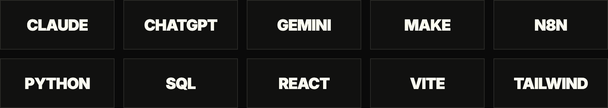
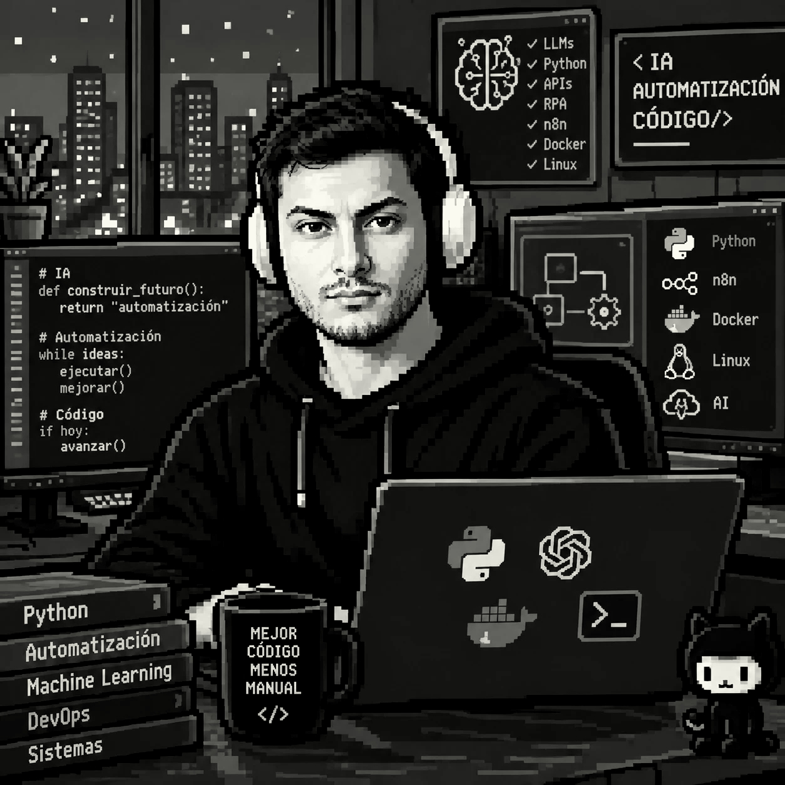

  

  Construyo agentes, automatizaciones y plataformas que le quitan trabajo manual a los equipos.

  &nbsp;&nbsp;
  &nbsp;&nbsp;
  

  <picture>
    <source media="(prefers-reduced-motion: reduce)" srcset="assets/cara-whoami-estatico.png">
    
  </picture>

| Proyecto | Qué es | Con qué |
|---|---|---|
| [Job Maps CO](https://jobmapsco.xyz) | Mapa de empleo de Colombia con relieve 3D. Laboratorio de Imderf, hecho con él. | MapLibre, deck.gl |
| [Oficina Live](https://github.com/Jaimex78/oficina-live) | Oficina virtual en pixel art con presencia en tiempo real, editor de oficina y Planner. Solo para computador. | TypeScript |
| [jaimeai.co](https://jaimeai.co) | Mi portafolio: casos con pantallas reales y un asistente que responde por mí. | React, Vite, Tailwind |

<table>
  <tr><td>Ahora</td><td>IA aplicada y automatización en Ogilvy</td></tr>
  <tr><td>Construyendo</td><td>Job Maps CO (con Imderf) y Oficina Live</td></tr>
  <tr><td>Estudio</td><td>Ingeniería Electrónica, UNAD (último semestre)</td></tr>
  <tr><td>Uso a diario</td><td>Claude, ChatGPT, Gemini, Make, n8n, Python y SQL</td></tr>
  <tr><td>Ciudad</td><td>Bogotá, Colombia</td></tr>
  <tr><td>Sitio</td><td><a href="https://jaimeai.co">jaimeai.co</a></td></tr>
</table>

 

Hecho en Bogotá con IA. Más en <a href="https://jaimeai.co">jaimeai.co</a>

